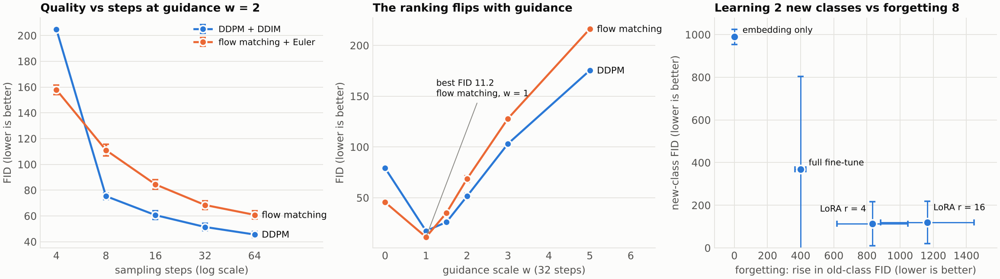
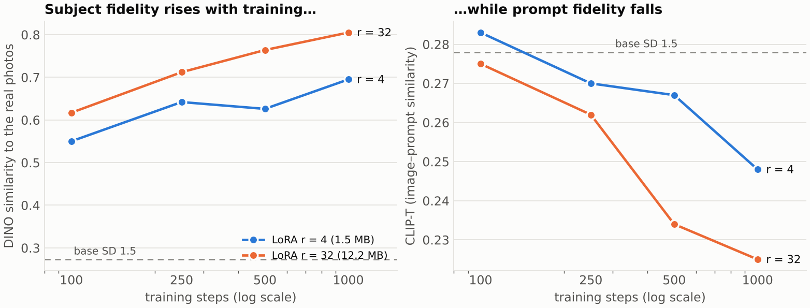
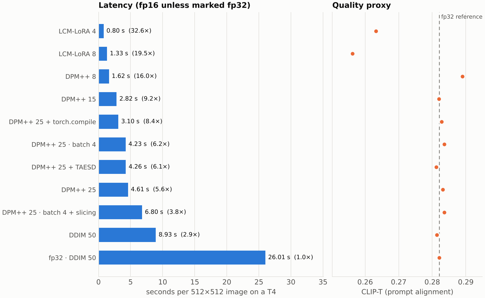

# Diffusion lab: flow matching vs DDPM, the cost of LoRA, and DreamBooth-LoRA on Stable Diffusion

[](https://colab.research.google.com/github/Ashhar-Hussain/genai-diffusion-lab/blob/main/01_flow_matching_vs_ddpm_lora.ipynb) notebook 1 · [](https://colab.research.google.com/github/Ashhar-Hussain/genai-diffusion-lab/blob/main/02_sd15_dreambooth_lora_t4.ipynb) notebook 2
    

Two notebooks about how image-generation models are trained, adapted and served, each executed end to end on a Colab T4.

## Notebook 1 · Flow matching vs DDPM, and what LoRA costs when a model learns new concepts

Plain PyTorch, nothing borrowed: a class-conditional U-Net with self-attention trained twice under an identical budget, once with **DDPM** (ε-prediction, cosine schedule, DDIM sampling) and once with **flow matching / rectified flow** (velocity prediction, logit-normal time sampling as in SD3, Euler sampling), both with classifier-free guidance. The model with the better FID at the reference setting (DDPM, 32 steps, w = 2) then learns two held-out Fashion-MNIST classes from 200 images each with **embedding-only tuning**, **LoRA** (rank 4 and 16, on every `Conv2d` and `Linear` layer outside the time embedding) or **full fine-tuning**, over three seeds. FID and KID use features from a classifier trained on the dataset, with sanity checks that the metric behaves.

**Experiment 1, objective, steps and guidance** (FID mean ± s.d. over two sampling seeds, 4,000 images each):

| sampling steps (w = 2) | 4 | 8 | 16 | 32 | 64 |
|---|---:|---:|---:|---:|---:|
| DDPM + DDIM | 204.9 ± 0.8 | 75.3 ± 2.5 | 60.6 ± 3.4 | 51.4 ± 2.8 | 45.5 ± 2.3 |
| flow matching + Euler | 157.9 ± 3.7 | 111.1 ± 4.7 | 84.4 ± 3.8 | 68.5 ± 3.3 | 60.8 ± 3.2 |

| guidance w (32 steps) | 0 | 1 | 1.5 | 2 | 3 | 5 |
|---|---:|---:|---:|---:|---:|---:|
| DDPM + DDIM, FID | 79.1 ± 1.0 | 17.3 ± 1.5 | 26.0 ± 1.8 | 51.4 ± 2.8 | 103.1 ± 2.0 | 175.3 ± 1.5 |
| DDPM + DDIM, class accuracy | 0.127 | 0.848 | 0.937 | 0.972 | 0.992 | 0.997 |
| flow matching + Euler, FID | 45.5 ± 1.4 | 11.2 ± 0.3 | 35.2 ± 2.2 | 68.5 ± 3.3 | 127.9 ± 1.8 | 216.2 ± 0.7 |
| flow matching + Euler, class accuracy | 0.128 | 0.889 | 0.959 | 0.981 | 0.994 | 0.998 |

**Experiment 2, learning two new classes from 200 images each** (DDPM model, mean ± 95% CI over three seeds, no replay of old classes):

| method | learning rate | trainable parameters | adapter (fp16) | new-class FID | old-class FID | old-class accuracy |
|---|---:|---:|---:|---:|---:|---:|
| before adaptation | – | – | – | 2498 | 49.2 | 0.970 |
| embedding only | 1e-2 | 256 | 0.5 KB | 989 ± 35 | 49 ± 0 | 0.970 |
| LoRA r = 4 | 1e-3 | 132,392 | 0.25 MB | 113 ± 104 | 881 ± 215 | 0.366 |
| LoRA r = 16 | 1e-3 | 528,800 | 1.01 MB | 119 ± 99 | 1213 ± 281 | 0.261 |
| full fine-tuning | 1e-4 | 1,744,289 | 3.33 MB | 368 ± 436 | 448 ± 32 | 0.624 |

**Experiment 3, inference on the T4** (DDPM, 32 steps, batch 256):

| variant | ms per image | speed-up | peak memory (MB) | FID |
|---|---:|---:|---:|---:|
| fp32 | 18.41 | 1.00× | 1057 | 45.90 |
| float16 autocast | 13.68 | 1.35× | 592 | 46.16 |
| autocast + channels_last | 15.66 | 1.18× | 692 | 46.06 |
| torch.compile (default) + autocast (compile 66 s) | 5.04 | 3.65× | 351 | 46.18 |
| torch.compile (reduce-overhead) + autocast (compile 37 s) | 6.33 | 2.91× | 66 | 46.09 |

**What this shows**

* FID here uses features of a classifier trained on Fashion-MNIST, so it is comparable only within this notebook (real-vs-real FID is 4.5).
* **Neither objective wins everywhere.** With 4 sampling steps flow matching is clearly better (FID 158 vs 205), but at guidance 2 DDPM is better from 8 steps on (45.5 vs 60.8 at 64 steps). The guidance sweep explains why: both models are over-guided at w = 2, and at the best setting (w = 1) flow matching leads, 11.2 vs 17.3. A fair comparison of objectives needs a guidance sweep, not one fixed w.
* **Guidance trades diversity for class fidelity:** class accuracy rises from 0.13 at w = 0 to 0.997 at w = 5, while FID gets worse beyond w = 1.
* **Learning new classes without replay damages the old ones.** At the learning rates commonly used for each method, LoRA learned the new classes best (new-class FID 113 and 119, against 368 for full fine-tuning) but also forgot the most (old-class FID 49 → 881 and 1,213; old-class accuracy 0.97 → 0.37 and 0.26). Full fine-tuning at a 10× smaller learning rate forgot less (448) and learned less, and tuning only the new class embeddings left the old classes untouched but learned little (989). Taken at face value this contradicts "LoRA learns less and forgets less" (Biderman et al., 2024); the likelier explanation is that the learning rates put each method at a different point of the same learning–forgetting curve. A matched-learning-rate sweep, or replaying a few old images, is the next experiment, and the intervals over three seeds are wide.
* **Inference:** `torch.compile` with fp16 autocast runs 3.65× faster than fp32 at batch 256 with unchanged FID (46.2 vs 45.9). fp16 alone gives 1.35×, and `channels_last` slows this small model down. Merging the LoRA weights removes the adapter overhead (19.5 → 13.5 ms per image). Throughput climbs from 1.3 images/s at batch 1 to 76 at batch 512, so small batches are bound by kernel launches, not arithmetic.



## Notebook 2 · DreamBooth-LoRA on Stable Diffusion 1.5, and the price of fast inference

A custom LoRA training loop on the SD 1.5 U-Net attention projections (fp16 base, fp32 adapters, loss scaling), trained on the five photos of `diffusers/dog-example` and evaluated with the DreamBooth metrics: **DINO** and **CLIP-I** similarity to the real photos (subject fidelity) and **CLIP-T** (prompt fidelity), on 8 prompts × 2 seeds per checkpoint.

| adapter | steps | DINO ↑ | CLIP-I ↑ | CLIP-T ↑ | size (MB, fp16) |
|---|---:|---:|---:|---:|---:|
| base model | 0 | 0.273 | 0.698 | 0.278 |  |
| r = 4 | 100 | 0.550 | 0.743 | 0.283 | 1.5 |
| r = 4 | 250 | 0.642 | 0.799 | 0.270 | 1.5 |
| r = 4 | 500 | 0.626 | 0.796 | 0.267 | 1.5 |
| r = 4 | 1000 | 0.695 | 0.807 | 0.248 | 1.5 |
| r = 32 | 100 | 0.617 | 0.772 | 0.275 | 12.2 |
| r = 32 | 250 | 0.712 | 0.823 | 0.262 | 12.2 |
| r = 32 | 500 | 0.764 | 0.836 | 0.234 | 12.2 |
| r = 32 | 1000 | 0.805 | 0.855 | 0.225 | 12.2 |

Subject fidelity rises with training steps and rank while prompt fidelity falls. At rank 32 and 1,000 steps DINO reaches 0.805 (base model 0.273) but CLIP-T drops to 0.225 (base 0.278): the adapter starts to ignore the prompt, the overfitting the DreamBooth paper warns about. Rank 4 at 250 steps is the balanced point, with DINO 0.642 and CLIP-T 0.270 in a 1.5 MB adapter. 1,000 training steps took 4.9 min at rank 4 and 4.7 min at rank 32 on the T4.



Inference on the T4 (base model, 12 prompts, 512×512; latency is the median per image, CLIP-T on the images each variant produced):

| variant | steps | s / image | speed-up | peak VRAM (GB) | CLIP-T |
|---|---:|---:|---:|---:|---:|
| fp32 · DDIM 50 | 50 | 26.01 | 1.0× | 7.7 | 0.282 |
| fp16 · DDIM 50 | 50 | 8.93 | 2.9× | 3.8 | 0.281 |
| fp16 · DPM-Solver++ 25 | 25 | 4.61 | 5.6× | 3.8 | 0.283 |
| fp16 · DPM-Solver++ 15 | 15 | 2.82 | 9.2× | 3.8 | 0.282 |
| fp16 · DPM-Solver++ 8 | 8 | 1.62 | 16.0× | 3.8 | 0.289 |
| fp16 · DPM-Solver++ 25 + TAESD | 25 | 4.26 | 6.1× | 3.1 | 0.281 |
| fp16 · LCM-LoRA 4 | 4 | 0.80 | 32.6× | 3.9 | 0.263 |
| fp16 · LCM-LoRA 8 | 8 | 1.33 | 19.5× | 3.9 | 0.256 |
| fp16 · DPM-Solver++ 25 · batch 4 | 25 | 4.23 | 6.2× | 6.4 | 0.284 |
| fp16 · DPM-Solver++ 25 · batch 4 + VAE & attention slicing | 25 | 6.80 | 3.8× | 3.8 | 0.284 |
| fp16 · DPM-Solver++ 25 + torch.compile | 25 | 3.10 | 8.4× | 3.8 | 0.283 |

* **fp16 is free:** 2.9× faster than fp32 at the same CLIP-T, with half the memory (3.8 vs 7.7 GB).
* **The solver is the biggest lever:** DPM-Solver++ at 15 steps is 9.2× faster than fp32 DDIM-50 with no measurable CLIP-T change (paired Wilcoxon p = 0.85 over the same prompts). CLIP-T did not drop even at 8 steps (+0.007, p = 0.15), a reminder that it measures prompt alignment, not fine detail.
* **`torch.compile` (max-autotune)** makes DPM-Solver++ 25 1.5× faster (3.10 vs 4.61 s) after a 12.4-minute compile, which only pays off in a long-running server.
* **LCM-LoRA** is the fastest (0.80 s per image at 4 steps, 32.6×) but costs 0.019 CLIP-T (p = 0.027); 8 LCM steps were no better (−0.026, p = 0.001).
* **Memory:** the tiny VAE decoder (TAESD) saves 0.65 GB and 8% latency at no CLIP-T cost. On a compute-bound T4, batch 4 raises throughput by only 9%, and VAE plus attention slicing cuts peak memory from 6.4 to 3.8 GB at 1.6× the latency.



## Run them

Open a notebook with its badge, choose *Runtime → Change runtime type → T4 GPU*, then *Run all*. Both notebooks save checkpoints and results to `MyDrive/genai-diffusion-lab/` and skip finished work when run again after a disconnect. Notebook 1 also runs on a CPU with a reduced budget.

## Citation

```bibtex
@software{hussain2026genaidiffusionlab,
  author  = {Hussain, Ashhar},
  title   = {Diffusion lab: flow matching vs DDPM, the cost of LoRA, and DreamBooth-LoRA on Stable Diffusion},
  year    = {2026},
  url     = {https://github.com/Ashhar-Hussain/genai-diffusion-lab},
  version = {1.0.0}
}
```

## License

Code: MIT. Fashion-MNIST: MIT. Stable Diffusion 1.5: CreativeML Open RAIL-M. `diffusers/dog-example` photos: see the dataset card.
